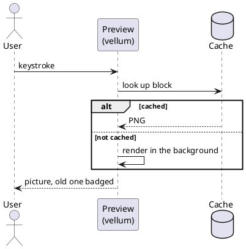
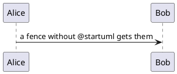

# PlantUML check

Visual checks for PlantUML, at the size of the mermaid diagrams in `docs/showcase.md`. Try: `nvim --clean -u test/init.lua test/plantuml.md -c Vellum`.

Needs `plantuml` on your `PATH`; without it these blocks show as code.

## Sequence



## Class

```plantuml
class Browser {
  -job
  +start()
  +diagram(code, lang)
}
class Cache {
  +key
  +prune()
}
Browser --> Cache : writes PNGs
```

## Activity, with a local include

```plantuml
!include plantuml-part.puml

start
:parse the block;
if (changed?) then (yes)
  :render;
else (no)
  :use the cached PNG;
endif
stop
```

## The diagram's own theme wins

```plantuml
!theme cerulean
skinparam backgroundColor #1B1B1F
skinparam defaultFontColor #F2F2F5

component "kitty or Ghostty" as T
component "headless Chrome" as R
T <-- R : kitty placeholders
```

<!-- broken on purpose: shows PlantUML's error under the block -->
```plantuml
class A {
```

## No wrapper needed


